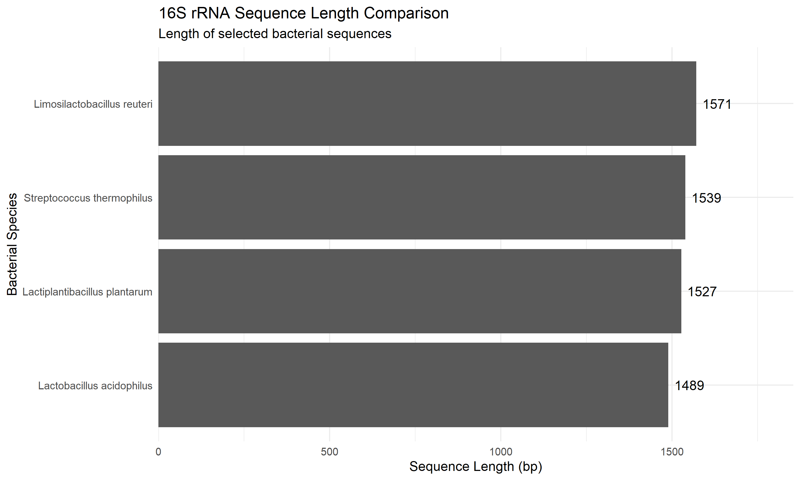
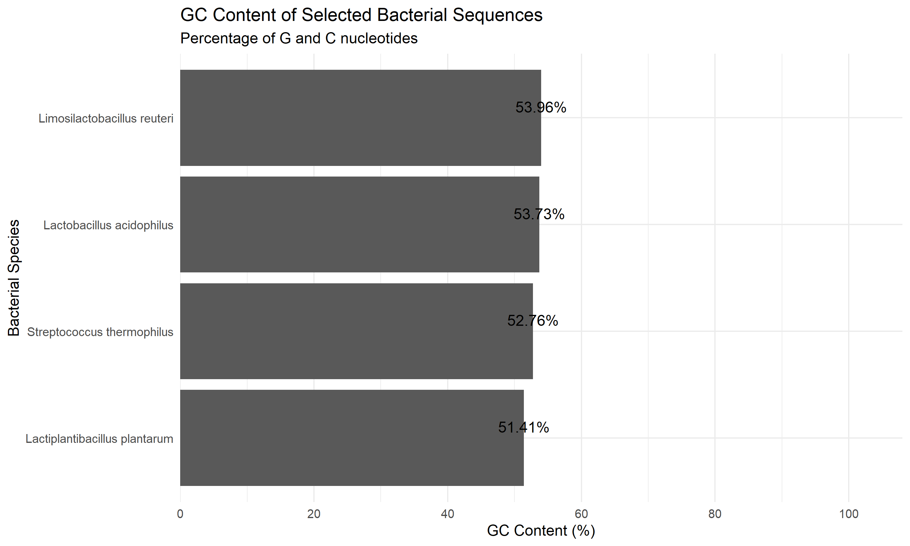
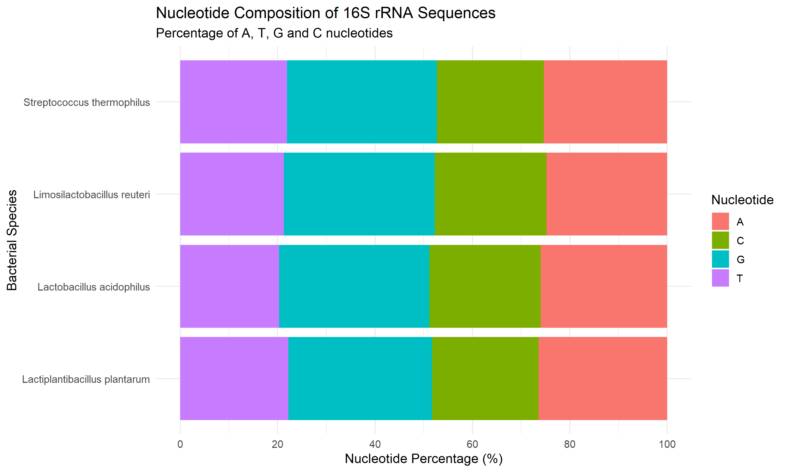
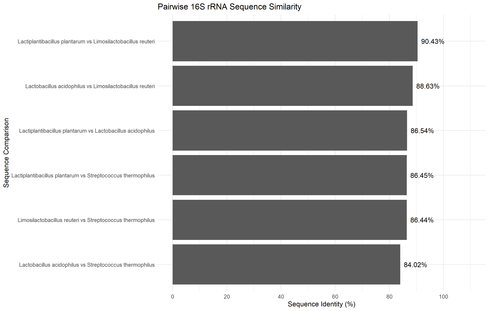

# Comparative 16S rRNA Sequence Analysis of Selected Lactic Acid Bacteria

**Bioinformatics ICA3 – 2026**  
**Student registration number:** 2021/ICT/81  
**Programming language:** R  
**Data source:** NCBI GenBank  
**Project type:** Comparative bacterial sequence analysis

---

## Abstract

This project compares publicly available 16S ribosomal RNA (16S rRNA) gene sequences from four selected lactic acid bacteria using R. Four records were downloaded from NCBI GenBank and examined through sequence quality checks, nucleotide composition analysis, multiple sequence alignment, pairwise sequence identity calculations, genetic-distance estimation and Neighbor-Joining phylogenetic analysis. The downloaded sequences ranged from 1,489 to 1,571 base pairs, with an average length of 1,531.5 bp. Their GC-content values ranged from 51.41% to 53.96%. The alignment contained 1,449 fully resolved positions, including 1,149 conserved and 300 variable sites. Pairwise identity ranged from 84.02% to 90.43%. The results describe the four selected database records only; they are not estimates of variation across whole bacterial populations.

## 1. Introduction

Bacteria are commonly compared using selected genetic markers because nucleotide sequences provide evidence that can be examined consistently across organisms. The 16S ribosomal RNA gene is widely used in bacterial sequence studies. It contains conserved regions as well as variable positions, allowing researchers to compare sequences and investigate similarities among bacterial records.

Lactic acid bacteria are a group of bacteria associated with lactic acid production and are relevant to food fermentation and other biological settings. This project examines four selected species: *Lactiplantibacillus plantarum*, *Lactobacillus acidophilus*, *Limosilactobacillus reuteri* and *Streptococcus thermophilus*. The work does not investigate antibiotic resistance or clinical treatment. Its focus is the comparison of 16S rRNA nucleotide sequences obtained from a public sequence database.

The practical problem addressed is how to organize, compare and interpret 16S rRNA sequences from different bacterial records using a reproducible bioinformatics workflow. Without a documented workflow, sequence records may be compared without checking record completeness, ambiguous nucleotide characters, sequence alignment or the number of positions that can fairly be compared. These issues can affect sequence-identity values and the interpretation of a phylogenetic tree.

The research question is: **What similarities and differences can be identified among the 16S rRNA sequences of the four selected lactic acid bacteria through nucleotide composition analysis, multiple sequence alignment, pairwise comparison and exploratory phylogenetic analysis?**

The aim is to investigate similarities and differences among the selected records using reproducible sequence-analysis methods in R.

The objectives are to: (1) obtain public 16S rRNA sequence records; (2) import and check the records; (3) describe sequence length, nucleotide composition and GC content; (4) align the sequences and calculate pairwise similarity; and (5) construct and interpret an exploratory Neighbor-Joining tree.

## 2. Data and Dataset Description

The nucleotide sequences were retrieved from the NCBI Nucleotide/GenBank database. The selected accession records are listed below. Accession numbers are included so that the original records can be checked and downloaded again.

| Organism | Strain | GenBank accession | Downloaded length |
|---|---|---|---:|
| *Lactiplantibacillus plantarum* | CIP 103151 | [NR_104573.1](https://www.ncbi.nlm.nih.gov/nuccore/NR_104573.1) | 1,527 bp |
| *Lactobacillus acidophilus* | NBRC 13951 | [AB680529.1](https://www.ncbi.nlm.nih.gov/nuccore/AB680529.1) | 1,489 bp |
| *Limosilactobacillus reuteri* | DSM 20016 | [X76328.1](https://www.ncbi.nlm.nih.gov/nuccore/X76328.1) | 1,571 bp |
| *Streptococcus thermophilus* | ATCC 19258 | [AY188354.1](https://www.ncbi.nlm.nih.gov/nuccore/AY188354.1) | 1,539 bp |

NCBI describes NR_104573.1 and AB680529.1 as partial 16S rRNA sequences. AY188354.1 is described as a complete 16S rRNA gene sequence. X76328.1 is identified by NCBI as a 16S rRNA gene record for *L. reuteri* DSM 20016. Record completeness is therefore not identical across all four entries and this is treated as a limitation when interpreting comparisons [1–4].

The dataset contains four sequence records, one representative record for each selected organism. The raw FASTA file is stored in `data/raw/selected_16s_sequences.fasta`, while its associated metadata is stored in `data/raw/sequence_metadata.csv`. The source accession numbers and record information are also documented in the data-import script.

The records are publicly accessible nucleotide database entries. No human participants, personal records or private clinical data were used. The project does not involve laboratory experiments. Users should follow the source database's terms and cite the accession records when reusing the sequence data. The NCBI record pages are the primary references for the sequence identifiers and annotations.

## 3. Methods

### 3.1 Software and packages

All processing and analysis were carried out in R using RStudio. The `rentrez` package was used to retrieve sequence records through NCBI's Entrez utilities. `Biostrings` was used to import, represent and manipulate DNA sequences. `DECIPHER` was used for multiple sequence alignment. `ggplot2` was used to create exploratory figures, and `ape` was used to calculate and display phylogenetic results [5–9]. The installed package and R versions can be checked using `sessionInfo()`.

### 3.2 Data retrieval and import

The script `code/01_data_import.R` defines the four accession numbers and downloads their nucleotide records in FASTA format. It saves the raw sequence file and creates a metadata table containing organism, strain and accession information. Sequence lengths are calculated from the imported records rather than entered manually.

### 3.3 Quality checking and preprocessing

The script `code/02_data_cleaning.R` imports the raw FASTA file and checks that the number of sequences matches the metadata. It matches FASTA headers to accession numbers, standardizes sequence letters to uppercase and checks the nucleotide symbols against the standard IUPAC DNA alphabet. It also counts ambiguous characters and identifies exact duplicate sequences.

Ambiguous nucleotide symbols are not automatically treated as errors. For example, `N` represents an unknown nucleotide, while other IUPAC symbols can represent more than one possible base. The five ambiguous characters recorded in the *L. reuteri* sequence were retained. No sequences were removed during this preprocessing step. The cleaned FASTA file and quality-control summary are saved in `data/processed/`.

### 3.4 Exploratory sequence analysis

The script `code/03_exploratory_analysis.R` calculates sequence length and counts the four unambiguous nucleotides (A, T, G and C). GC content is calculated as:

\[
GC\ content\ (\%) = \frac{G+C}{A+T+G+C}\times 100
\]

Ambiguous characters are excluded from the denominator because their nucleotide identity is unknown. Nucleotide percentages are calculated using the total number of unambiguous A, T, G and C characters. The script exports summary CSV files and generates three figures: sequence-length comparison, GC-content comparison and nucleotide composition.

### 3.5 Alignment and conserved-site analysis

The script `code/04_sequence_analysis.R` uses `DECIPHER::AlignSeqs()` to produce a multiple sequence alignment. The aligned sequences are saved as a FASTA file. Alignment columns containing only A, T, G or C in all four sequences are treated as fully resolved. A column is counted as conserved when all four bases are identical. A fully resolved column with at least two different bases is counted as variable. Columns containing gaps or ambiguous characters are reported separately and are not included in the conserved or variable counts.

### 3.6 Pairwise identity and genetic distance

For each of the six possible pairs, positions are considered comparable only when both sequences contain an unambiguous A, T, G or C at the aligned position. Percentage identity is calculated as matching comparable positions divided by all comparable positions, multiplied by 100. The uncorrected p-distance is calculated as one minus the fraction of matching positions. The script records the number of comparable sites, matching sites, percentage identity, p-distance and alignment coverage for each pair.

### 3.7 Phylogenetic analysis

A distance matrix is formed from the pairwise p-distances and used with the Neighbor-Joining function in `ape`. The resulting tree is an exploratory, unrooted representation of the distances among the four selected sequence records. No outgroup or bootstrap support analysis was included, so the tree should not be interpreted as a fully supported or definitive evolutionary history.

## 4. Results

### 4.1 Sequence length and nucleotide composition

The four sequence lengths were 1,527 bp for *L. plantarum*, 1,489 bp for *L. acidophilus*, 1,571 bp for *L. reuteri* and 1,539 bp for *S. thermophilus*. The mean sequence length was 1,531.5 bp. The longest downloaded record was *L. reuteri* and the shortest was *L. acidophilus*.

| Organism | A | T | G | C | Ambiguous bases | GC content |
|---|---:|---:|---:|---:|---:|---:|
| *L. plantarum* | 403 | 339 | 451 | 334 | 0 | 51.41% |
| *L. acidophilus* | 387 | 302 | 460 | 340 | 0 | 53.73% |
| *L. reuteri* | 388 | 333 | 485 | 360 | 5 | 53.96% |
| *S. thermophilus* | 390 | 337 | 474 | 338 | 0 | 52.76% |

The GC-content values ranged from 51.41% to 53.96%. *L. reuteri* had the highest value (53.96%), while *L. plantarum* had the lowest (51.41%). The mean of the four reported, rounded record-level GC percentages was approximately 52.96%. The five ambiguous characters in *L. reuteri* were excluded from the GC-content denominator.







### 4.2 Multiple sequence alignment

The multiple sequence alignment contained 1,580 columns. Of these, 1,449 were fully resolved canonical nucleotide positions. Within those fully resolved positions, 1,149 were conserved and 300 were variable. The remaining 131 alignment columns contained gaps or ambiguous characters. Therefore, approximately 79.3% of fully resolved positions were conserved and 20.7% were variable.

### 4.3 Pairwise sequence comparison

The pairwise identity values ranged from 84.02% to 90.43%. The highest value was between *L. plantarum* and *L. reuteri*: 1,379 of 1,525 comparable positions matched, giving 90.43% identity and a p-distance of 0.095738. The lowest value was between *L. acidophilus* and *S. thermophilus*: 1,225 of 1,458 comparable positions matched, giving 84.02% identity and a p-distance of 0.159808.

| Pairwise comparison | Matching / comparable sites | Identity | p-distance | Coverage |
|---|---:|---:|---:|---:|
| *L. plantarum* – *L. acidophilus* | 1,279 / 1,478 | 86.54% | 0.134641 | 93.54% |
| *L. plantarum* – *L. reuteri* | 1,379 / 1,525 | 90.43% | 0.095738 | 96.52% |
| *L. plantarum* – *S. thermophilus* | 1,295 / 1,498 | 86.45% | 0.135514 | 94.81% |
| *L. acidophilus* – *L. reuteri* | 1,318 / 1,487 | 88.63% | 0.113652 | 94.11% |
| *L. acidophilus* – *S. thermophilus* | 1,225 / 1,458 | 84.02% | 0.159808 | 92.28% |
| *L. reuteri* – *S. thermophilus* | 1,319 / 1,526 | 86.44% | 0.135649 | 96.58% |

The arithmetic mean of the six pairwise identity percentages was approximately 87.08%. This is a descriptive average across the six comparisons, not a species-level statistic.



### 4.4 Phylogenetic result

A Neighbor-Joining tree was generated from the p-distance matrix and saved as a PNG image. The displayed unrooted topology places *L. plantarum* with *S. thermophilus* on one side and *L. acidophilus* with *L. reuteri* on the other. This is consistent with a four-point distance check: the sums for the three possible four-taxon splits were 0.270290, 0.255546 and 0.249166, respectively; the smallest sum corresponds to the split (*L. plantarum*, *S. thermophilus*) | (*L. acidophilus*, *L. reuteri*). The final tree should be regenerated using `code/05_finalize_tree.R` so that the Newick file and PNG are both built directly from the committed pairwise-distance CSV.

## 5. Discussion

The exploratory analysis showed that the four downloaded records differ in sequence length and nucleotide composition. The GC-content values were relatively close, with a range of approximately 2.55 percentage points between the lowest and highest records. This describes the composition of the selected sequence records; it should not be generalized to all strains or all members of each bacterial species.

The alignment contained a majority of conserved fully resolved positions, together with 300 variable positions. This indicates that the selected records share many aligned nucleotide positions while also containing sequence differences. The 131 columns with gaps or ambiguous characters demonstrate why alignment coverage and treatment of uncertain bases should be reported alongside identity percentages.

Pairwise comparison found the greatest identity between *L. plantarum* and *L. reuteri* and the lowest identity between *L. acidophilus* and *S. thermophilus*. These rankings apply to the particular accession records and the comparison rule used here. Identity percentages are affected by which alignment positions are comparable; therefore, the number of comparable sites and alignment coverage are reported with each percentage.

The phylogenetic tree provides a compact visualization of the distance matrix, but it should be interpreted cautiously. Only four sequences were included, no bootstrap resampling was performed, and the records are not equally described in terms of completeness. A Neighbor-Joining tree based on one marker is not, by itself, enough to establish a definitive evolutionary history. A larger dataset, consistent sequence-region selection, additional markers or whole-genome comparisons, and branch-support analysis would be required for stronger evolutionary conclusions.

A further limitation is that this project uses one record per species. The four records are not biological replicates, so inferential tests comparing within-species variation cannot be justified. The analysis is descriptive and computational. It also does not test bacterial phenotype, pathogenicity, antibiotic susceptibility or clinical relevance. The project should not be interpreted as an antimicrobial-resistance study.

## 6. Conclusion and Future Work

This project established a reproducible R workflow for retrieving, checking, describing, aligning and comparing four public 16S rRNA records from selected lactic acid bacteria. The sequences ranged from 1,489 to 1,571 bp, GC content ranged from 51.41% to 53.96%, and the alignment contained 1,149 conserved and 300 variable fully resolved positions. Pairwise identity ranged from 84.02% to 90.43%.

The findings answer the research question at the level of the four selected database records. They show measurable sequence similarity as well as variation, but they do not support population-wide or definitive evolutionary conclusions. Future work could include more strains per species, carefully matched full-length 16S rRNA records, additional genetic markers, bootstrap support for phylogenetic branches and an independent sequence-alignment validation step.

## 7. Reproducibility and How to Run

Clone the public GitHub repository and open the `.Rproj` file in RStudio. Use the repository root as the working directory. Install the required packages once:

```r
install.packages(c("rentrez", "ggplot2", "ape"))
install.packages("BiocManager")
BiocManager::install(c("Biostrings", "DECIPHER"))
```

Run the scripts in this order:

1. `code/01_data_import.R` – retrieves the accession records from NCBI and writes the raw FASTA and metadata files.
2. `code/02_data_cleaning.R` – validates and standardizes the downloaded sequences and writes the processed files.
3. `code/03_exploratory_analysis.R` – calculates sequence lengths, nucleotide composition and GC content, and creates the EDA figures and tables.
4. `code/04_sequence_analysis.R` – aligns the sequences, counts conserved and variable sites, calculates pairwise identity and p-distances, and creates the initial tree outputs.
5. `code/05_finalize_tree.R` – rebuilds the final Neighbor-Joining tree directly from the saved pairwise p-distance table and writes a four-point diagnostic.

The raw dataset is included in `data/raw/` for inspection, while the import script allows it to be retrieved again from NCBI. Because remote database records can be updated, users should record the retrieval date and compare the downloaded sequences with the committed FASTA file when reproducing the work. Run `sessionInfo()` in R to record the local R and package versions.

## References

1. NCBI. *Lactiplantibacillus plantarum* strain CIP 103151 16S ribosomal RNA, partial sequence. GenBank accession **NR_104573.1**. https://www.ncbi.nlm.nih.gov/nuccore/NR_104573.1
2. NCBI. *Lactobacillus acidophilus* gene for 16S rRNA, partial sequence, strain NBRC 13951. GenBank accession **AB680529.1**. https://www.ncbi.nlm.nih.gov/nuccore/AB680529.1
3. NCBI. *L. reuteri* DSM 20016 16S rRNA gene record. GenBank accession **X76328.1**. https://www.ncbi.nlm.nih.gov/nuccore/X76328.1
4. NCBI. *Streptococcus thermophilus* strain ATCC 19258 16S ribosomal RNA gene, complete sequence. GenBank accession **AY188354.1**. https://www.ncbi.nlm.nih.gov/nuccore/AY188354.1
5. Winter, D. (2025). *rentrez: 'Entrez' in R*. R package version 1.2.4. https://CRAN.R-project.org/package=rentrez
6. Pagès, H. et al. *Biostrings: Efficient manipulation of biological strings*. Bioconductor. https://bioconductor.org/packages/Biostrings/
7. Bioconductor. *DECIPHER: Tools for curating, analyzing, and manipulating biological sequences*. Package documentation. https://bioconductor.org/packages/DECIPHER/
8. Paradis, E., Claude, J., & Strimmer, K. (2004). APE: Analyses of Phylogenetics and Evolution in R language. *Bioinformatics*, 20(2), 289–290. https://doi.org/10.1093/bioinformatics/btg412
9. Wickham, H. (2016). *ggplot2: Elegant Graphics for Data Analysis*. Springer. https://ggplot2.tidyverse.org
10. R Core Team. (2026). *R: A Language and Environment for Statistical Computing*. R Foundation for Statistical Computing, Vienna, Austria. https://www.R-project.org/